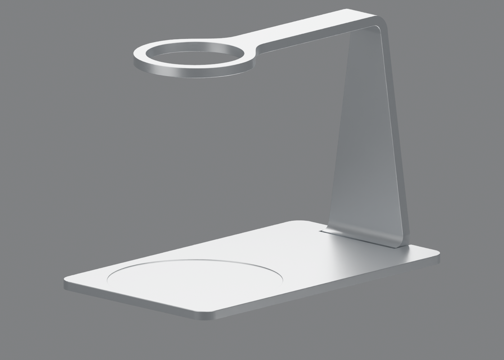

# Project Zoe

**An open-source manual pour-over stand concept in satin silver aluminum.**

[Interactive website](https://e7h4n.github.io/project-zoe/) · [Blender source](model/project-zoe.blend)



## Current revision

- Fixed, level manual dripper ring replaces the historical automated crown and adjustable arm.
- Original weighing top/seat and reviewed upper stand retained; lower bend and rear joint revised for the aligned base.
- Three-layer serial weighing concept: table → new ground plate G → total-load sensor → integrated floor/upright M → carafe sensor → cover C.
- Reviewed stack: C roof 1.5 mm + 0.5 mm gap + M web 1 mm + 0.5 mm gap + G 1 mm = 4.5 mm.
- C has straight 3 mm skirts below its roof, flush with G's underside. There is no inward folded return. G is 0.5 mm inside the skirt's **inner** walls, not its outside silhouette.
- The whole Y10–32 bridge is continuously 1 mm thick. M/G outer contours align; their rear Y12 cross-edges align with the weighing roof.
- The lower bend tangent is raised to Z0.5 with an outer R9.5 arc (inner R5 retained), aligning with the ground plate and skirt underside. No rubber feet added yet.
- **Sensors and their mounts are not yet installed or selected.** One sensor per interface is preferred, subject to eccentric-load, moment and capacity verification. The model is not a working scale.

After common tare, the total channel would measure system mass increment, the carafe channel beverage increment, and their difference approximately dripper-retained water. Evaporation, leaks, dynamic forces, channel timing and drift affect this estimate.

## Nominal geometry

| Feature | Design dimension |
| --- | --- |
| Cover plan envelope | 100 × 170 mm, R8 plan corners |
| Cover top / carafe seat | Z5 / Z4.5 mm; Ø85 mm seat at X0/Y125 |
| Cover roof underside / top | Z3.5 / Z5 mm; thickness 1.5 mm (1 mm at the recessed seat) |
| Middle horizontal web and rear bridge | Z2–3 mm, continuously 1 mm thick after Y10 |
| New ground plate G | 96.6 × 166.6 × 1 mm, R6.3; X±48.3, Y1.7–168.3; Z0.5–1.5 |
| Nominal vertical gaps | C → M: 0.5 mm; M → G: 0.5 mm |
| Straight skirt | Z0.5–3.5, extends 3 mm below roof; 1.2 mm wall |
| G plan clearance | 0.5 mm from inner skirt walls; exterior inset from C is 1.7 mm |
| Rear openings | C roof and M/G cross-edges all end at Y12; G/M notch X±27.5; C notch X±25.8 |
| Rear side-skirt ends | Y11.5, leaving 0.5 mm before the Y12 plate edge |
| M/G exterior contour | Shared 96.6 × 166.6 mm, R6.3 |
| Stack height | 4.5 mm, Z0.5–5; bend, G and skirt undersides all align at Z0.5 |
| Sensor space / table clearance | **Not validated. Thickness allocation is an appearance assumption.** |
| Fixed ring | OD60 / ID48 mm, center X0/Y125, Z113.5–118.5 |
| Seat-to-ring underside | 109 mm; nominal 99 mm server leaves 10 mm to ring, not necessarily dripper outlet |

The skirt arrangement follows the reviewed dimensions, not a sensor packaging solution. The skirt conceals G from the exterior sides and ends flush with G's bottom. The rear central opening must remain clear where M passes through; a downward crosswall there would cause interference/force bypass. The bend, G and skirt all end at Z0.5; the stand and moving cover must not touch the table during weighing, so future feet and load-dependent clearances are still required before this can function as a scale. No claim of stiffness, sensor fit, loaded clearance or manufacturing readiness is made. The carafe seat dimension remains a design input, not an independently verified HARIO specification.

### Aligned-edge three-millimeter skirt revision (2026-11-14)

`docs/flush-base/` contains current CAD and mesh QA, colored CAD details/sections, silver renders and an explanatory exploded view. The .blend is saved assembled, not exploded. Three CAD parts are valid single solids without nominal intersections; all three pairwise minimum distances are 0.5 mm. Thirteen rear-neck thickness probes are exactly 1 mm; mesh ray checks also cover the formerly missed neck. The reviewed Blender upper geometry above Z10 is preserved exactly. The CAD full-stand export retains its prior nominal, unsoftened upper geometry; local Blender edge softening remains a display refinement.

`docs/equal-gap-bottom/` and `docs/three-layer/` are historical and do not describe the current flush model.

## Source files

| Path | Contents |
| --- | --- |
| `model/project-zoe.blend` | Current three-layer manual assembly, studio camera and lighting; Blender 5.0.1 |
| `cad/base.step` | 1.5 mm weighing roof and straight 3 mm skirts; unchanged seat/top |
| `cad/ground-plate-concept.step` | Provisional new inset ground plate G |
| `cad/manual-fixed-upper.step` | Nominal manual upper support solid; Blender mesh has local edge softening |
| `cad/fixed-base-local.step` | Current thinned web and retained large rear bend, not full upright |
| `cad/Project_Zoe_flush_assembly.step` | Complete nominal three-part flush assembly |
| `scripts/build_flush_base.py`, `scripts/apply_flush_base.py` | Pinned-CAD rebuild and Blender lower-region update |
| `docs/flush-base/` | Current dimension/check receipts and review renders |
| `docs/equal-gap-bottom/` | Historical shortened G contour checks and bottom views |
| `docs/three-layer/` | Historical skirt-extension stage checks and renders (before G was shortened) |
| `scripts/check_model.py` | Current mesh topology, floor, seat, ring and ground-plate geometry checks |
| `scripts/export_glb.py` | Current three-object Blender → compressed GLB export |
| `web/` | Interactive Three.js viewer with twelve desktop/mobile camera presets |

Other CAD, renders and reconstruction scripts are **historical studies**, not the current complete assembly. In particular, `build_base.py`, `build_upper.py`, `rebuild_rounded_shell.py`, `apply_upper.py` and `check_historical_automatic_model.py` describe the older automated-crown design and must not be used to regenerate the current assembly. The complete prior version is retained in [Git history at a0b18dd](https://github.com/e7h4n/project-zoe/tree/a0b18dd297a377172f05ef80fcb6f4c9e32a9d0a). There is no complete parametric CAD regeneration pipeline for the new assembly yet.

Current checks confirm three valid manifold product meshes, a continuous 1 mm neck/web, a 4.5 mm stack with skirt/G undersides aligned at Z0.5, preserved seat and unchanged Blender upper geometry above Z10. CAD checks confirm three valid single solids with no nominal intersections. These checks do not evaluate deflection, contact under load, tolerances or real weighing behavior.

## Interactive controls

Left drag / one finger: orbit. Right drag: pan. Wheel: zoom. Two fingers: pan/pinch. Focus the canvas for arrow-key pan, `+`/`−` zoom and `R`/`Home` reset. Twelve preset buttons include elevations, ring details, weighing surface, rear joint, skirt and underside. Reduced motion is respected; rendering is on demand.

## Build and deployment

Use Python 3.11 and Node.js 22 on Linux:

```sh
python3.11 -m venv .venv
. .venv/bin/activate
pip install -r requirements-export.txt
npm ci
npm run build
python -m http.server 8080 --directory dist
```

Build opens Blender with script auto-execution disabled, validates current geometry and exports only `BrewDuo_C_shell_5mm`, `weighed_base` and `New_recessed_ground_plate_CONCEPT`. Studio objects are excluded. Millimeters convert to glTF meters/Y-up; silver PBR material is applied in memory without changing the source. Draco and viewer assets are self-hosted and content-hashed.

```sh
npx playwright install --with-deps chromium
npm test
```

Tests cover materials, dimensions, mouse/touch/keyboard controls, all twelve desktop/mobile views, responsive framing and reduced motion. Set `PLAYWRIGHT_CHROMIUM_EXECUTABLE_PATH` for an installed Chromium. Relevant pushes to `main` run build/tests before GitHub Pages deployment. PRs upload QA artifacts without deploying. The live `model-manifest.json` records source, script, dependency, commit and asset hashes. The separate original `project-zoe.okou.app` page is historical, not this CI target.

## Status and next engineering work

**Design concept, not manufacturing-ready hardware.** A 1–2000 g net range and 0.1 g display increment are goals, not verified ±0.1 g accuracy. Total-stage capacity must include the stand, utensils and contents; tare does not reduce mechanical loading.

Next: select actual sensors, fit mounts within the serial sandwich, calculate cumulative deflection/moments and tipping, establish tolerance-based gaps, design two-stage overload stops and flexible wiring without force bypasses, then test synchronized channels for repeatability, corner loading, thermal drift, creep and response delay. Food-contact suitability, sealing, fabrication and physical edge safety remain unvalidated. Use caution with hot water and glassware.

## License

[MIT](LICENSE) for authored code, model, CAD and artwork, provided as-is. Third-party trademarks are not licensed. See [third-party notices](THIRD_PARTY_NOTICES.txt) for Three.js and Draco licenses.
