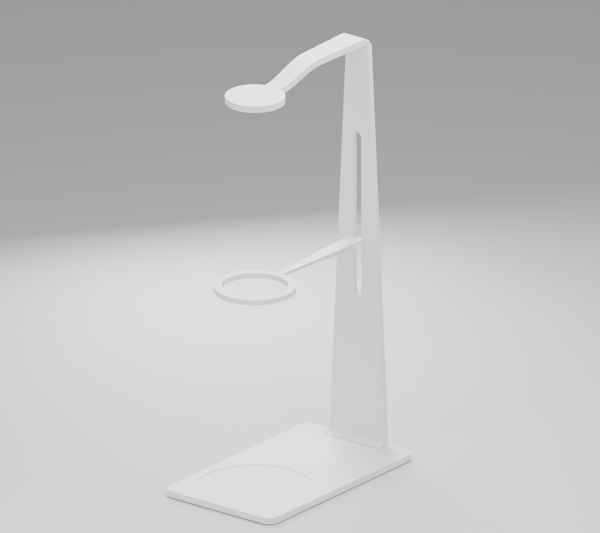

# Project Zoe

**The ultimate elegant coffee brewing tool.**

An open-source pour-over stand concept. A circular crown, a dripper support, and a slender base, shown as a single white model.

[Website](https://e7h4n.github.io/project-zoe/) · [Original concept page](https://project-zoe.okou.app) · [Blender source](model/project-zoe.blend)



## Source files

| Path | Contents |
| --- | --- |
| `model/project-zoe.blend` | Complete exterior assembly, aluminum materials, camera and studio lights. Blender 5.0.1. |
| `cad/base.step` | Engineering solid of the recessed weighing base **only**, not the complete assembly. |
| `cad/base-before-recess.step` | Rounded base before the circular recess, for rebuilding the base. |
| `scripts/build_base.py` | Parametric CadQuery construction of the recessed base. |
| `web/index.html` | Responsive single-screen concept page. No framework, external fonts, analytics or account required. |
| `scripts/render_site.py` | Headless Blender render and content-hashed website image build. |
| `docs/` | White-model previews, section detail and geometric checks. |

All model coordinates are in millimeters. The `.blend` keeps the original aluminum finish; the website renderer applies white-clay materials in memory without saving over the source model. Hidden accessory proxies and unrelated scene objects have been removed from the published file. No external textures or supplier CAD are required.

## Blender → website CI

Every relevant push to `main`:

1. Loads the actual `model/project-zoe.blend` with automatic script execution disabled.
2. Renders a white-model image using **Blender 5.0.1 / Cycles CPU**.
3. Produces desktop and mobile WebP crops with content-hashed filenames.
4. Builds and checks the static site. `render-manifest.json` records the source model hash, render script hash, commit, Blender version, render settings and output image hashes.
5. Publishes the result to **GitHub Pages** at <https://e7h4n.github.io/project-zoe/>.

Pull requests render and upload a downloadable `rendered-website` Actions artifact, but do not deploy. Manual builds are available from the Actions tab. Actions are pinned to commit SHAs. Rendering has read-only repository permissions, no project secrets, and does not commit generated images back into the repository. Deployment has only the additional Pages/OIDC permissions it needs.

The existing `project-zoe.okou.app` URL is an initial snapshot, not an automatic CI deployment target. GitHub Pages is the continuously rendered site. No Okou account or credential is needed to build or deploy this repository.

### Render locally

Use Python 3.11 on Linux. `bpy` is a large dependency (the headless Blender Python module); a GPU is not required.

```sh
python3.11 -m venv .venv
. .venv/bin/activate
pip install -r requirements-render.txt
python scripts/render_site.py --out dist
python scripts/check_site.py dist
python -m http.server 8080 --directory dist
```

Open <http://localhost:8080>. For a faster draft, pass `--samples 8` to the render script. Ubuntu may also need `libegl1 libgl1 libxkbcommon0 libxi6 libxrender1`; the CI workflow installs these explicitly.

### Edit the model

Open `model/project-zoe.blend` in Blender 5.0.1 or newer, edit the model, save and commit. The next CI build renders the changed geometry automatically. Keep the three product object names and `Studio_ground` intact; the render script checks for the expected assembly. Camera, white material and studio render settings are defined in `scripts/render_site.py` so the website framing remains consistent.

### Why not load `.blend` directly in the browser?

Browsers do not natively display Blender project files. This website intentionally serves lightweight rendered images rather than a 3D runtime. An interactive viewer would use an exported **GLB/glTF** model with Three.js or `<model-viewer>`, not the `.blend` itself. That can be added later without changing the Blender source-of-truth approach.

## Base geometry

- Overall base: **100 × 170 × 5 mm**; R8 plan corners, nominal R0.35 exposed perimeter edges.
- Circular flat seat: **Ø85 mm**, centered at **X0 / Y125**, coaxial with the dripper support.
- Recess: **0.5 mm** deep; remaining floor thickness **4.5 mm**.
- S transition: two tangent, oppositely curved **R0.25** quarter circles, tangent to both planes. Radial blend width **0.5 mm**, outer transition diameter **Ø86 mm**.
- Rear mating/connection edges are deliberately excluded from exterior edge rounding.

The seat diameter is a user-specified nominal bottom diameter for a HARIO 360 mL server, **not** an independently verified manufacturer dimension. No extra radial fit allowance has been added. HARIO is a third-party trademark; this project is not affiliated with or endorsed by HARIO.


Rebuild the base separately (CadQuery is not needed for website rendering):

```sh
pip install cadquery==2.8.0
python scripts/build_base.py
```

This updates the base STEP/STL only; it does **not** silently modify the Blender assembly. Replace `weighed_base` in Blender with the resulting STL, preserve the material and normals setup, and save before committing to update website geometry.

## Status and safety

**Design concept, not manufacturing-ready hardware.** Weighing internals, electronics, mounting, tolerances, deflection under load, food-contact suitability, thermal behavior, fabrication and physical edge safety have not been engineered or certified. Numeric checks validate the stated exterior geometry, not those functional properties. Use caution with hot water and fragile glassware.

## License

[MIT](LICENSE), covering the authored code, model, CAD and artwork in this repository. Provided as-is, without warranty. Third-party trademarks are not licensed.
