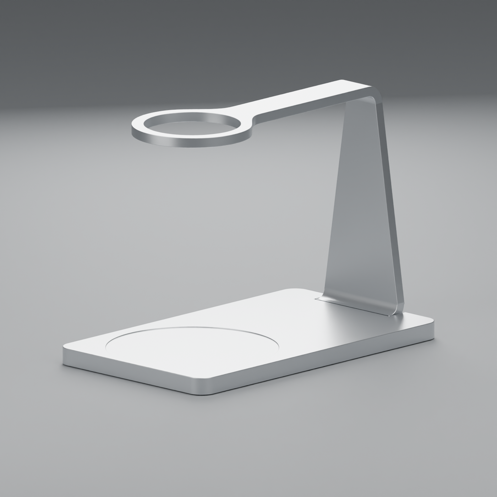
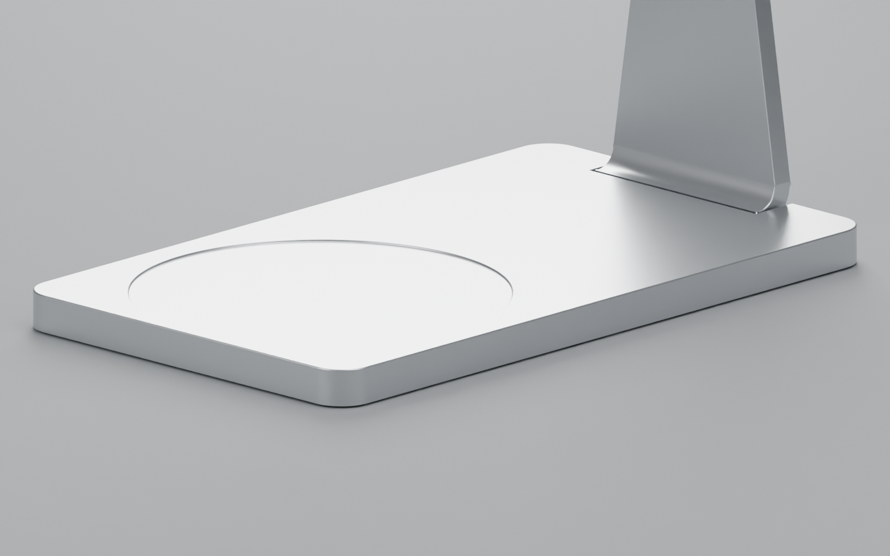

# Project Zoe

**An open-source manual pour-over stand concept in satin silver aluminum.**

[Interactive website](https://e7h4n.github.io/project-zoe/) · [Blender source](model/project-zoe.blend)



## Current revision

- Fixed, level manual dripper ring replaces the historical automated crown and adjustable arm.
- Original continuous weighing surface, recessed carafe seat and rear base joint retained.
- Three-layer serial weighing concept: table → new ground plate G → total-load sensor → integrated floor/upright M → carafe sensor → cover C.
- Only the cover's exterior skirts extend downward, concealing G without a new seam across the weighing surface. Rear-notch inner walls retain their clearance.
- **Sensors and their mounts are not yet installed or selected.** One sensor per interface is preferred, subject to eccentric-load, moment and capacity verification. The model is not a working scale.

After common tare, the total channel would measure system mass increment, the carafe channel beverage increment, and their difference approximately dripper-retained water. Evaporation, leaks, dynamic forces, channel timing and drift affect this estimate.

## Nominal geometry

| Feature | Design dimension |
| --- | --- |
| Cover plan envelope | 100 × 170 mm, R8 plan corners |
| Cover top / carafe seat | Z5 / Z4.5 mm; Ø85 mm seat at X0/Y125 |
| Cover roof underside / floor top | Z3.8 / Z2 mm; only 1.8 mm original upper cavity |
| Outer skirt bottom | Z−3.5 mm, extended 4.3 mm from Z0.8 |
| New inset ground plate G | 94 × 164 × 2 mm, R8; center X0/Y85; Z−4 to −2 |
| Overall base height | 9 mm, Z−4 to Z5; no longer the historical 5 mm envelope |
| Nominal skirt/table gap | 0.5 mm, **not validated under load or tolerance stack-up** |
| Fixed ring | OD60 / ID48 mm, center X0/Y125, Z113.5–118.5 |
| Seat-to-ring underside | 109 mm; nominal 99 mm server leaves 10 mm to ring, not necessarily dripper outlet |

Extending the skirt does **not** enlarge the original C/M cavity. Ground-plate size and gaps are provisional. No claim of sensor fit, loaded clearance or manufacturing readiness is made. The carafe seat dimension is a design input, not an independently verified HARIO specification.



## Source files

| Path | Contents |
| --- | --- |
| `model/project-zoe.blend` | Current three-layer manual assembly, studio camera and lighting; Blender 5.0.1 |
| `cad/base.step` | Current cover with extended exterior skirts; unchanged upper surface |
| `cad/ground-plate-concept.step` | Provisional new inset ground plate G |
| `cad/manual-fixed-upper.step` | Nominal manual upper support solid; Blender mesh has local edge softening |
| `cad/fixed-base-local.step` | Retained original integrated floor/rear-joint CAD, not full upright |
| `docs/three-layer/` | Nominal CAD checks, preservation fingerprints and current renders |
| `scripts/check_model.py` | Current mesh topology, floor, seat, ring and ground-plate geometry checks |
| `scripts/export_glb.py` | Current three-object Blender → compressed GLB export |
| `web/` | Interactive Three.js viewer with twelve desktop/mobile camera presets |

Other CAD, renders and reconstruction scripts are **historical studies**, not the current complete assembly. In particular, `build_base.py`, `build_upper.py`, `rebuild_rounded_shell.py`, `apply_upper.py` and `check_historical_automatic_model.py` describe the older automated-crown design and must not be used to regenerate the current assembly. The complete prior version is retained in [Git history at a0b18dd](https://github.com/e7h4n/project-zoe/tree/a0b18dd297a377172f05ef80fcb6f4c9e32a9d0a). There is no complete parametric CAD regeneration pipeline for the new assembly yet.

CAD comparisons confirm no changed upper cover volume above Z1.1 and no nominal intersection with the original fixed base or G. Mesh checks confirm manifold geometry and unchanged middle/ground mesh fingerprints during skirt extension. These checks do not evaluate deflection, contact under load, tolerances or real weighing behavior.

## Interactive controls

Left drag / one finger: orbit. Right drag: pan. Wheel: zoom. Two fingers: pan/pinch. Focus the canvas for arrow-key pan, `+`/`−` zoom and `R`/`Home` reset. Twelve preset buttons include elevations, ring details, weighing surface, rear joint, skirt and underside. Reduced motion is respected; rendering is on demand.

## Build and deployment

Use Python 3.11 and Node.js 22 on Linux:

```sh
python3.11 -m venv .venv
. .venv/bin/activate
pip install -r requirements-export.txt
npm ci
npm run build
python -m http.server 8080 --directory dist
```

Build opens Blender with script auto-execution disabled, validates current geometry and exports only `BrewDuo_C_shell_5mm`, `weighed_base` and `New_recessed_ground_plate_CONCEPT`. Studio objects are excluded. Millimeters convert to glTF meters/Y-up; silver PBR material is applied in memory without changing the source. Draco and viewer assets are self-hosted and content-hashed.

```sh
npx playwright install --with-deps chromium
npm test
```

Tests cover materials, dimensions, mouse/touch/keyboard controls, all twelve desktop/mobile views, responsive framing and reduced motion. Set `PLAYWRIGHT_CHROMIUM_EXECUTABLE_PATH` for an installed Chromium. Relevant pushes to `main` run build/tests before GitHub Pages deployment. PRs upload QA artifacts without deploying. The live `model-manifest.json` records source, script, dependency, commit and asset hashes. The separate original `project-zoe.okou.app` page is historical, not this CI target.

## Status and next engineering work

**Design concept, not manufacturing-ready hardware.** A 1–2000 g net range and 0.1 g display increment are goals, not verified ±0.1 g accuracy. Total-stage capacity must include the stand, utensils and contents; tare does not reduce mechanical loading.

Next: select actual sensors, fit mounts within the serial sandwich, calculate cumulative deflection/moments and tipping, establish tolerance-based gaps, design two-stage overload stops and flexible wiring without force bypasses, then test synchronized channels for repeatability, corner loading, thermal drift, creep and response delay. Food-contact suitability, sealing, fabrication and physical edge safety remain unvalidated. Use caution with hot water and glassware.

## License

[MIT](LICENSE) for authored code, model, CAD and artwork, provided as-is. Third-party trademarks are not licensed. See [third-party notices](THIRD_PARTY_NOTICES.txt) for Three.js and Draco licenses.
