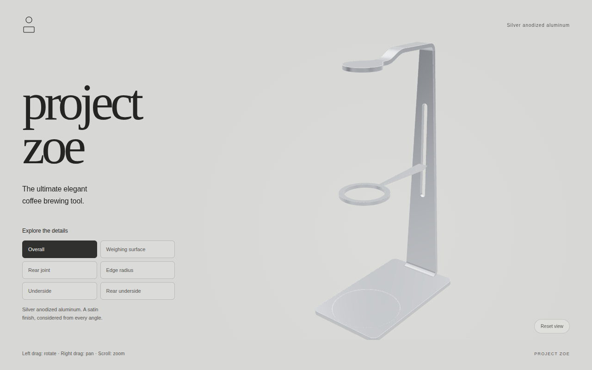
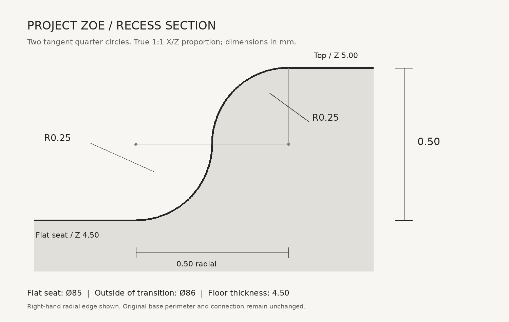
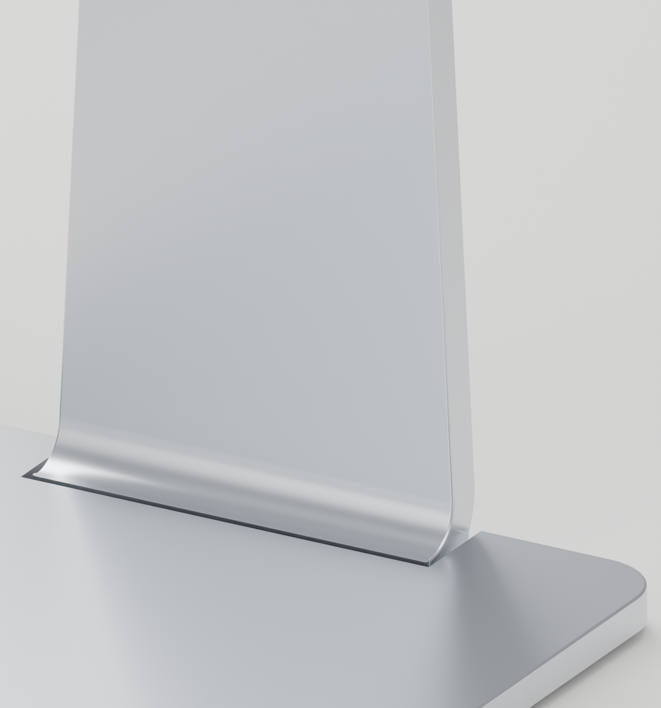
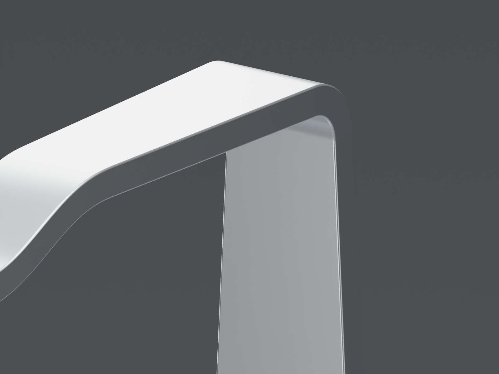
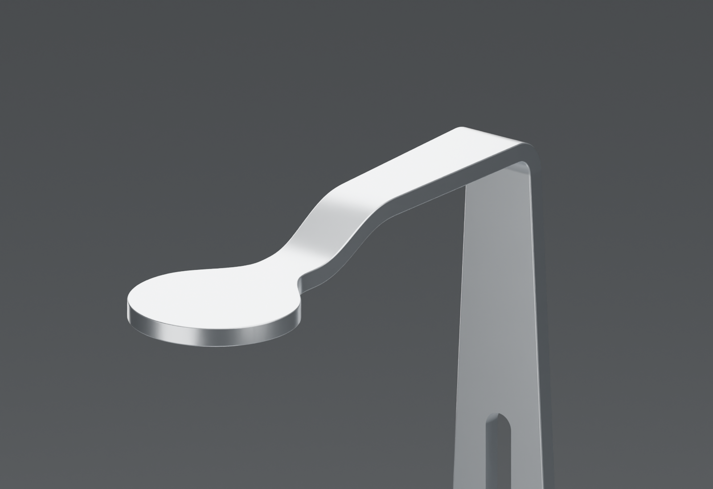
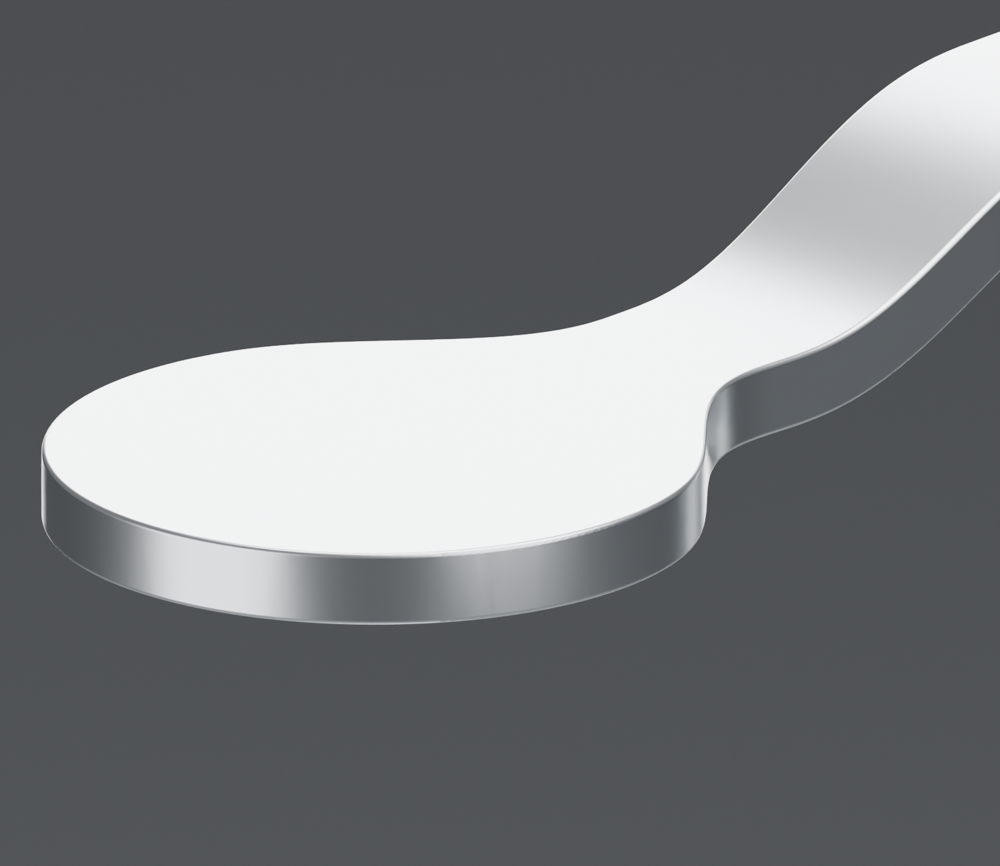
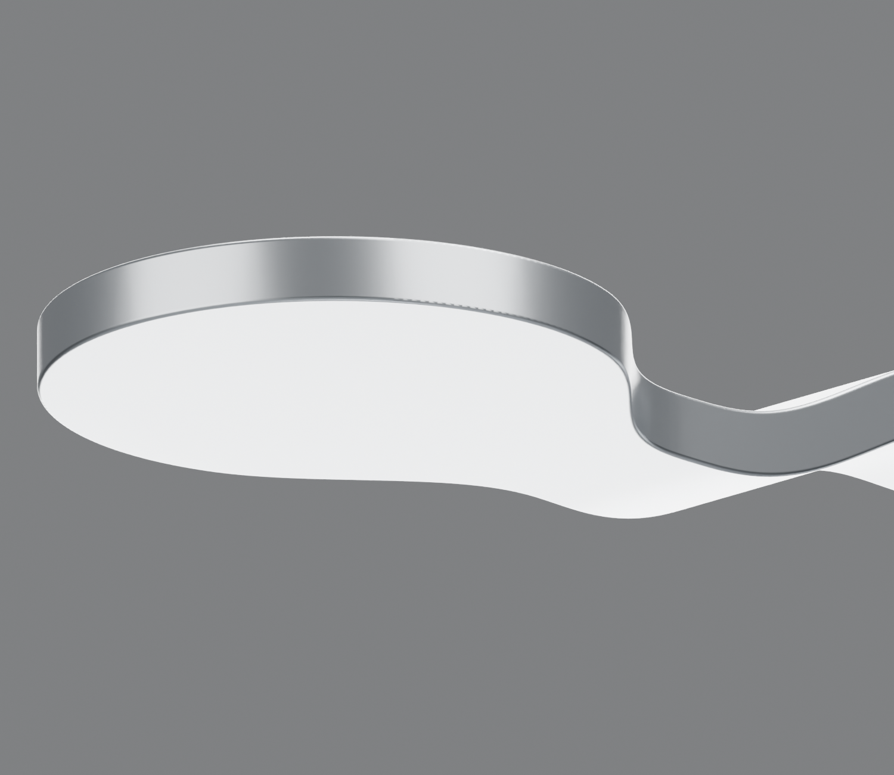
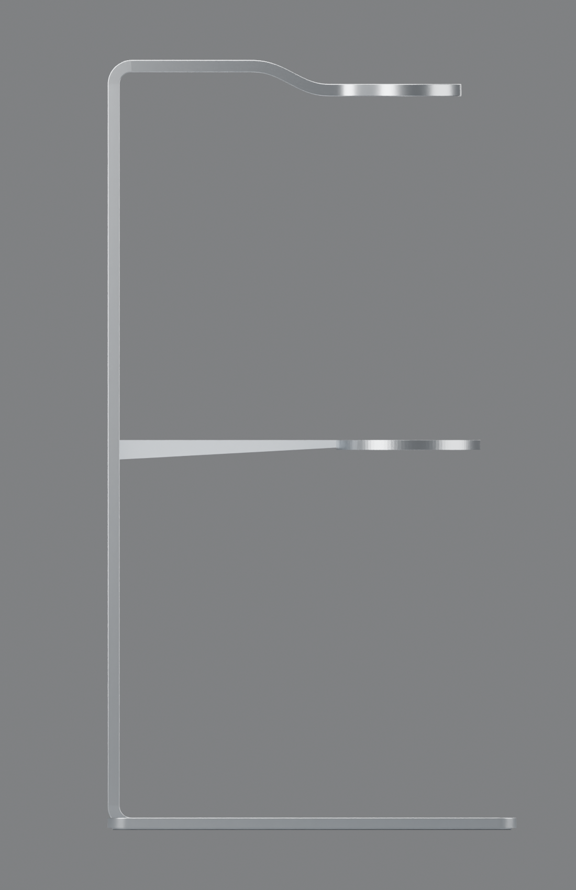
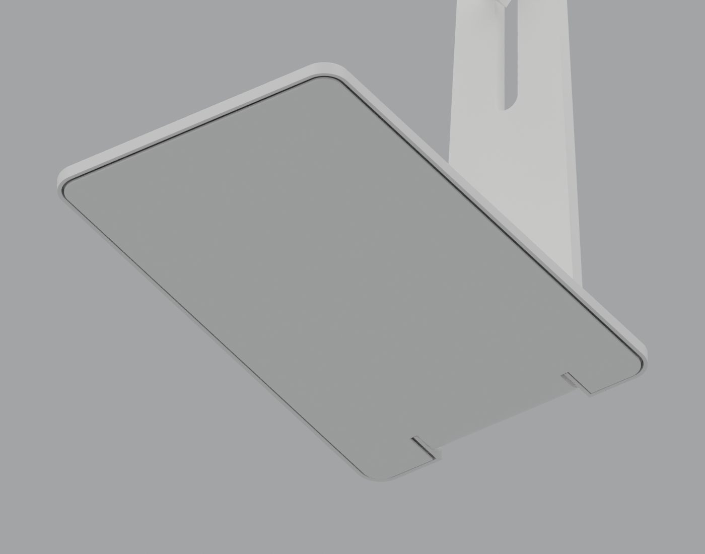
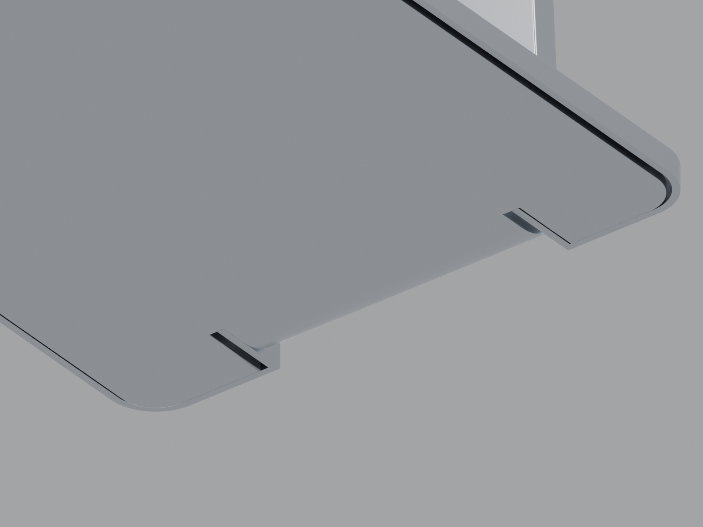

# Project Zoe

**The ultimate elegant coffee brewing tool.**

An open-source pour-over stand concept. A circular crown, a dripper support, and a slender base. Explore the real 3D assembly in satin silver anodized aluminum, with one-click views of the important design details.

[Interactive website](https://e7h4n.github.io/project-zoe/) · [Blender source](model/project-zoe.blend)



## 3D controls

| Input | Action |
| --- | --- |
| Left mouse drag | Orbit / rotate |
| Right mouse drag | Pan |
| Mouse wheel / middle drag | Zoom |
| One-finger drag | Rotate |
| Two-finger drag / pinch | Pan / zoom |
| Arrow keys (viewer focused) | Pan |
| `+` / `−` (viewer focused) | Zoom |
| `R`, `Home`, or **Reset view** | Restore the initial view |
| Detail buttons | Smoothly frame the selected detail; continue orbiting, panning and zooming freely |

Six preset buttons cover **Overall**, **Weighing surface** (Ø85 seat), **Rear joint**, **Edge radius** (R0.35 upper edge), **Underside** (contour-matched plate) and **Rear underside** (rear wings/stand connection). Their targets are defined in original design millimeters, converted to the displayed model space, and reframed for desktop and mobile aspect ratios. Selected buttons expose `aria-pressed`; reduced-motion users get immediate camera changes. Reset always returns to the overall composition.

The viewer uses Three.js and OrbitControls. Context menus are suppressed **only inside the 3D canvas**. It renders on demand, with damping while moving; it does not auto-rotate. Keyboard focus is visible, and the model can be downloaded if WebGL is unavailable.

## Blender → GLB → website CI

Every relevant push to `main`:

1. Opens the actual `model/project-zoe.blend` in headless **Blender 5.0.1**, with automatic script execution disabled.
2. Exports only the three product meshes, applying modifiers and a silver anodized aluminum PBR material in memory (metallic 1, roughness 0.32). Cameras, studio lights, floor and accessory proxies are excluded.
3. Converts millimeters to glTF's meter units, uses Y-up, and applies **Draco compression**. Base display normals are smoothed while preserving >30° creases; vertices and original CAD geometry are unchanged. High-precision 20-bit position quantization keeps the small recess transition visually intact.
4. Bundles the viewer and self-hosted Draco decoder, producing content-hashed assets. No CDN, account, project secret or external texture is needed at runtime.
5. Validates the GLB structure, product objects, local assets and source/output hashes.
6. Runs real Chromium tests for the silver PBR material, dimensions, left-drag rotation, right-drag pan, wheel zoom, reset, keyboard, mobile layout, touch rotate/pan/pinch, all six desktop/mobile preset views, rapid switching, responsive reframing and reduced motion.
7. Deploys to **GitHub Pages** at <https://e7h4n.github.io/project-zoe/>.

`model-manifest.json` on the live site records the Blender-source hash, export/build scripts, dependency lockfile, commit and exported asset hashes. The full Blender source remains unchanged by export.

Pull requests build and upload an `interactive-website-and-qa` Actions artifact, including the GLB and browser screenshots, but **do not deploy**. Manual builds are available from the Actions tab. Actions are pinned to commit SHAs. Build/test has read-only repository access; deployment has only the additional Pages/OIDC permissions it needs. Failed browser tests block deployment.

The website now loads an actual GLB, not a pre-rendered image. The `.blend` remains the editable source of truth. `docs/preview.png` is a static documentation illustration. The original <https://project-zoe.okou.app> page is a separate historical snapshot, not the automatic CI target.

## Source files

| Path | Contents |
| --- | --- |
| `model/project-zoe.blend` | Complete exterior assembly, original aluminum materials, camera and studio lights. Blender 5.0.1. |
| `cad/base.step` | Approved hollow weighing cover with restored rear side wings and R0.35 upper edges; not the complete assembly. |
| `cad/fixed-base-local.step` | Local fixed rear joint and integrated contour-matched flat floor, used for clearance checks; not the full upright. |
| `cad/upper-tangent.step` | Exact upper solid from Z294 upward, including bend, downset and tangent crown transition; not the full upright or assembly. |
| `scripts/build_upper.py` | Builds the C2 plan transition and applies R0.35 after exact solid union. |
| `scripts/apply_upper.py` | Replaces the upper portion of the Blender shell with that CAD-derived mesh. |
| `cad/fixed-rear-joint.step` | Retained original central joint, used by `scripts/build_floor.py` to rebuild the fixed base. |
| `cad/base-before-recess.step` | Historical solid base before the circular recess, not the current cover. |
| `scripts/build_base.py` | Parametric CadQuery construction of the recessed base. |
| `scripts/export_glb.py` | Headless Blender → compressed GLB export. |
| `scripts/build_site.mjs` | Export, bundle and assemble the static website. |
| `scripts/check_site.py` | GLB, asset and provenance validation. |
| `scripts/test_viewer.mjs` | Real browser mouse, keyboard, touch and responsive tests. |
| `web/` | Responsive page and interactive Three.js viewer. |
| `docs/` | Static previews, section detail and geometric checks. |

The Blender scene uses millimeters. There are no external textures or supplier CAD dependencies. Hidden accessory proxies and unrelated scene objects have been removed from the published model.

## Build locally

Use Python 3.11 and Node.js 22 on Linux. `bpy` is the large headless Blender Python module; no GPU or Blender executable is required to export.

```sh
python3.11 -m venv .venv
. .venv/bin/activate
pip install -r requirements-export.txt
npm ci
npm run build
python -m http.server 8080 --directory dist
```

Open <http://localhost:8080>. Ubuntu may also need `libegl1 libgl1 libxkbcommon0 libxi6 libxrender1`; the workflow installs these explicitly.

To run the browser checks:

```sh
npx playwright install --with-deps chromium
npm test
```

Software WebGL is enabled for headless CI. Tests write desktop, mobile and rotated screenshots to `test-results/`. To test with an existing Chromium executable, set `PLAYWRIGHT_CHROMIUM_EXECUTABLE_PATH`.

### Edit the model

Open `model/project-zoe.blend` in Blender 5.0.1 or newer, edit, save and commit. Preserve the three product object names: `BrewDuo_C_shell_5mm`, `Triangular_pyramid_arm_flat_face_UP`, and `weighed_base`. The next CI build exports the changed geometry and updates the interactive website. The source keeps its aluminum finish; the consistent silver PBR material is applied during export only. The browser uses studio environment reflections to show the satin finish; this is an appearance approximation, not a measured anodizing specification. Camera framing, named detail views, lighting and controls are in `web/viewer.js`.

## Base geometry

- Overall base assembly envelope: **100 × 170 × 5 mm**; cover R8 plan corners and **R0.35 upper perimeter edges**.
- Independent hollow weighing cover: top Z5, underside Z3.8, skirt bottom Z0.8; nominal top/side thickness **1.2 mm** (local rounding and reliefs vary).
- Restored rear side wings extend to Y0 and wrap around the upright, with the central notch X±25.8 ending at Y12. No full-width forward rear closure.
- Fixed upright and flat bottom plate are united in the Blender source. The floor follows the cover contour, including the rear side wings: **96 × 166 × 2.0 mm**, spanning Y2–168, with R6 plan corners. Its contour is inset 2 mm from the cover exterior, giving a nominal **0.8 mm side gap** to the 1.2 mm skirt. The floor notch is X±27.8 through Y14; the original central stand tongue is retained. No separate raised perimeter frame.
- The fixed floor and retained central tongue now share **Z2.0**: the former 0.8 mm step at Y32 is removed. Nominal vertical space below the Z3.8 cover roof is **1.8 mm**.
- The short downturned lip at the central rear notch (X±25.8, Y12–13.2) is removed below Z3.8. The top surface, rear side wings and other cover skirts are retained.
- The upright's exposed longitudinal edges have a real **R0.35 mm** rounded mesh profile, continuing along the inner lower bend **and through the upper bend, downset arm and both circular crown rims**. The upper structure is now rebuilt as an exact solid and rounded **after** union, rather than rounding overlapping mesh parts. `scripts/check_model.py` verifies topology, upright and upper-rim cross-sections, and actual flare contour against CAD parameters.
- The crown remains **R22, centered X0/Y125, Z305–310**. Its side rails now widen smoothly from the arm between **Y94 and Y118**, using quintic Beziers matching position, tangent and curvature (C2) to both straight taper and circle. The downset ends at Y94 with zero slope and curvature; its total drop remains 10 mm. This replaces the former abrupt arm/circle intersection, not merely its shading.
- The upright front/back planes remain vertical and **90° to the fixed floor**. The upright narrows in plan width, but its guide direction does not lean. The support-ring center remains **X0/Y125** during ideal vertical translation. `docs/geometry-checks.json` records sampled planes and fitted ring-center coordinates at three heights. This is a geometry check, **not** validation of a real slider/lock or its tolerances.
- `scripts/rebuild_rounded_shell.py` rebuilds the lower assembly from pinned source `7aaa157` and current generated floor/cover STLs, then calls `apply_upper.py` with the new upper CAD mesh. It overwrites `model/project-zoe.blend`.
- Circular flat seat: **Ø85 mm**, centered at **X0 / Y125**, coaxial with the dripper support.
- Recess: **0.5 mm** deep; nominal remaining cover roof thickness beneath its flat region is **0.7 mm**. This is an appearance prototype, not a validated structural thickness.
- S transition: two tangent, oppositely curved **R0.25** quarter circles, tangent to both planes. Radial blend width **0.5 mm**, outer transition diameter **Ø86 mm**.
- Rear mating/connection edges are deliberately excluded from exterior edge rounding.

The seat diameter is a user-specified nominal bottom diameter for a HARIO 360 mL server, **not** an independently verified manufacturer dimension. No extra radial fit allowance has been added. HARIO is a third-party trademark; this project is not affiliated with or endorsed by HARIO.



Rebuild the base separately (CadQuery is not needed for website export):

```sh
pip install cadquery==2.8.0
python scripts/build_floor.py
python scripts/build_base.py
python scripts/build_upper.py
# In the Blender Python environment, after all three CAD generators:
python scripts/rebuild_rounded_shell.py
```

`build_floor.py` rebuilds the local fixed floor/joint CAD and `docs/floor-checks.json` from the retained joint. `build_base.py` updates the cover STEP/STL and `docs/checks.json` only; it does **not** silently modify the Blender assembly. It also checks clearance against `cad/fixed-base-local.step`. Replace `weighed_base` in Blender with the resulting STL, preserve material/normals setup, and save before committing to update website geometry. Internal cavity, fastening and sensor fit remain unvalidated.

### Approved edge and floor revision



`cad/center-section-AA.dxf` contains the revised exact X0 local CAD section; `cad/bottom-half-section.step` is a half-section of those local solids. They describe the floor/cover revision, **not** a complete parameterized upright. The lower upright edge fillets remain authored in the Blender mesh. The upper structure from Z294 upward now has its own exact solid in `cad/upper-tangent.step`; there is still no single complete parameterized upright/assembly. `docs/upright-radius-check.json` and `docs/geometry-checks.json` record current mesh measurements. The upper mesh uses 0.005 mm absolute STL deflection and a 0.075 rad angular limit; mesh-check tolerances include tessellation error and are not manufacturing tolerances.

Every website build checks source topology, uniform Z2 floor, removed rear lip, R0.35 upright/arm/crown profiles, C2 flare contour, upright perpendicularity and ideal ring-center alignment before export.







### Contour-matched underside





These are approved design-review renders, not evidence of sensor fit or manufacturing readiness.

## Status and safety

**Design concept, not manufacturing-ready hardware.** Weighing internals, electronics, mounting, tolerances, deflection under load, food-contact suitability, thermal behavior, fabrication and physical edge safety have not been engineered or certified. Numeric checks validate the stated exterior geometry, not those functional properties. Use caution with hot water and fragile glassware.

## License

[MIT](LICENSE) for the authored code, model, CAD and artwork. Provided as-is, without warranty. Third-party trademarks are not licensed. Three.js and the Draco decoder retain their respective MIT and Apache-2.0 licenses; see [third-party notices](THIRD_PARTY_NOTICES.txt), also included in the built site.
